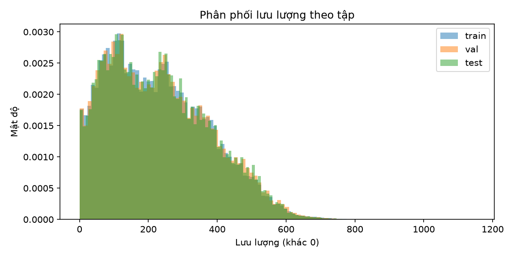
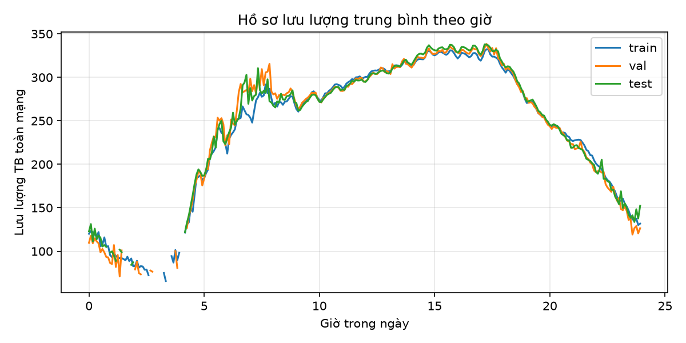
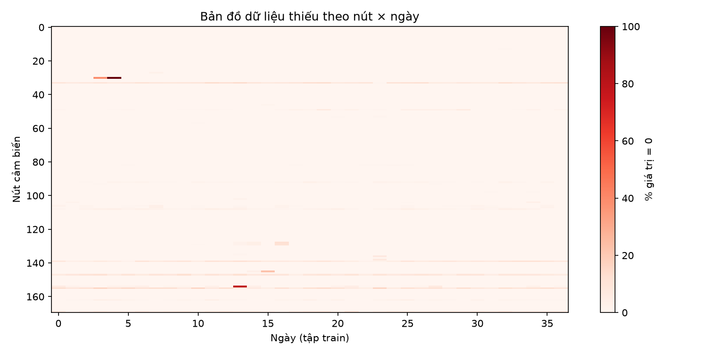
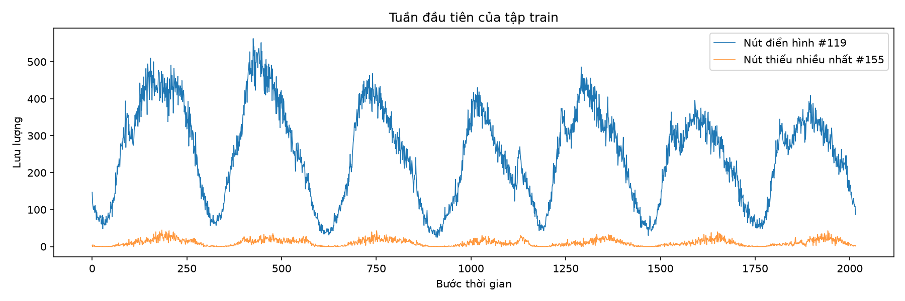

# Báo cáo dữ liệu PEMS08

Tạo lúc 2026-10-28 01:28:50 · fingerprint `917cf8a1f7bd`

## Tổng quan

| Tập | x shape | y shape | Độ dài chuỗi | % giá trị 0 | TB (≠0) | Std (≠0) | Liên tục |
|---|---|---|---|---|---|---|---|
| train | (10699, 12, 170, 3) | (10699, 12, 170, 1) | 10722 | 0.344% | 230.32 | 145.28 | 100% |
| val | (3567, 12, 170, 3) | (3567, 12, 170, 1) | 3590 | 0.379% | 233.61 | 147.50 | 100% |
| test | (3567, 12, 170, 3) | (3567, 12, 170, 1) | 3590 | 0.336% | 232.48 | 146.15 | 100% |

- Tỷ lệ chia: {'train': 0.6, 'val': 0.2, 'test': 0.2}
- Tổng số bước thời gian ước lượng: 17856
- Tỷ lệ giá trị 0 toàn bộ: 0.350%
- Scaler (train, gồm cả 0): mean=229.859, std=145.623
- Bài báo (Table 2): 170 nút, 17856 bước, missing 0.696%

## Cảnh báo

- **WARN**: [train] nút 107 lặp nguyên một giá trị 101 bước liên tiếp (≥1 giờ) → nghi cảm biến lỗi
- **WARN**: [val] nút 78 lặp nguyên một giá trị 59 bước liên tiếp (≥1 giờ) → nghi cảm biến lỗi
- **WARN**: [test] nút 78 lặp nguyên một giá trị 104 bước liên tiếp (≥1 giờ) → nghi cảm biến lỗi

## Hình

